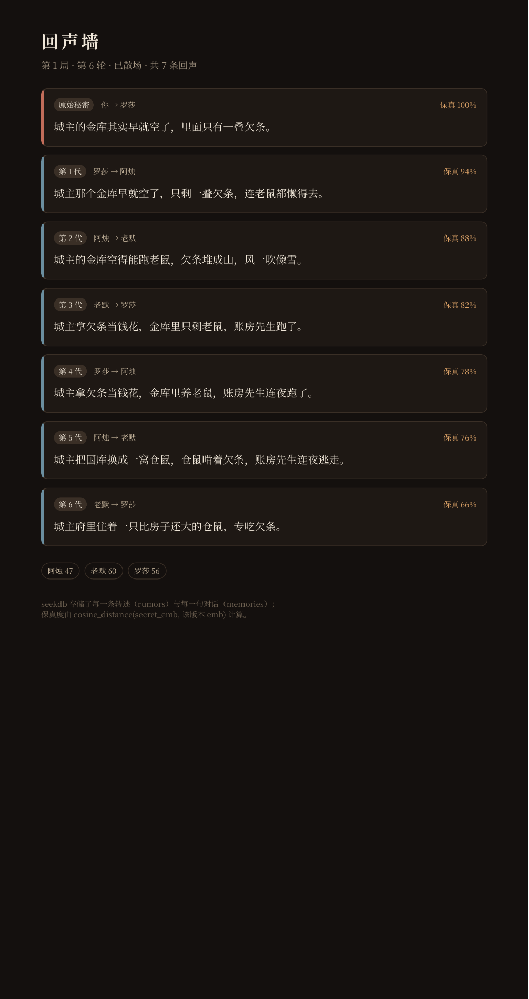

# 运行证据

> 运行时间：2026-10-28 00:40 ～ 01:20（Asia/Shanghai）
> 机器：4 核 / 9 GB 内存 / 无 GPU / **无 Docker**
> seekdb：`5.7.25-OceanBase seekdb-v1.4.0.0`，`127.0.0.1:2881`（队内长期实例）
> Embedding：Ollama `qwen3-embedding:0.6b`（1024 维）
> 后端：FastAPI，`127.0.0.1:8765`

## 1. 证据清单

| 文件 | 说明 |
|---|---|
| [`evidence/graphon-inspect.log`](evidence/graphon-inspect.log) | 用 **Dify 1.18 自带 graphon 0.8.0 引擎**加载 DSL：`status: loadable` |
| [`evidence/check-dsl.log`](evidence/check-dsl.log) | 离线检查：11 节点 / 10 边 / 26 处变量引用；代码节点带样例执行 |
| [`evidence/unit-tests.log`](evidence/unit-tests.log) | 14 个单元测试全部通过 |
| [`evidence/health.json`](evidence/health.json) | seekdb + embedding 双连通 |
| [`evidence/init-db.log`](evidence/init-db.log) | 5 张表、3 个 NPC 种子、IK 全文索引、HNSW 向量索引 |
| [`evidence/seekdb-queries.txt`](evidence/seekdb-queries.txt) | 7 代传播链、12 条记忆、信任值、索引类型（真实 SQL 输出） |
| [`evidence/echo-api.json`](evidence/echo-api.json) | `/api/v1/echo` 返回：每一代的 `distance` 与 `fidelity` |
| [`evidence/rehearse-script.log`](evidence/rehearse-script.log) | 6 轮完整流程（脚本回放 LLM 节点，见 §4 说明） |
| [`evidence/backend.log`](evidence/backend.log) | 后端逐请求日志（含 `retrieval` 双路召回记录） |
| [`evidence/retrieval.log`](evidence/retrieval.log) | 从日志里摘出的 5 条混合检索记录 |
| [`evidence/echo-wall.png`](evidence/echo-wall.png) | 回声墙实际渲染（910×1287 原图已放大到 1032×1948） |
| [`evidence/llm-0.5b-one-turn.log`](evidence/llm-0.5b-one-turn.log) | 真实 0.5B 模型单轮：模型没给出合法 JSON，代码节点兜底成功 |

## 2. Dify 引擎判定：DSL 可加载

Dify 1.18 的 `api/pyproject.toml` 把工作流运行时固定为 `graphon==0.8.0`（git rev `4fa2214`）。本机用同一版本做了 `inspect`：

```text
file: dsl/echo-tavern.chatflow.yml
kind: app
status: loadable
reason: None
nodes: 11
edges: 10
✓ Dify/graphon 认为这份 DSL 可以加载
```

> 这不等于“在 Dify UI 里点过发布”。本机没有 Docker，无法起完整 Dify；正式导入步骤见 README §5，DSL 的节点/连线/变量引用另有 `check_dsl.py` 做逐项检查。

## 3. seekdb 里实际有什么

`evidence/seekdb-queries.txt` 的真实输出（截取）：

```text
-- seekdb 版本
5.7.25-OceanBase seekdb-v1.4.0.0

-- 传播链（demo-2026-10-28b）
49  1  0  player  rosa  城主的金库其实早就空了，里面只有一叠欠条。
50  1  1  rosa    azhu  城主那个金库早就空了，只剩一叠欠条，连老鼠都懒得去。
51  1  2  azhu    momo  城主的金库空得能跑老鼠，欠条堆成山，风一吹像雪。
52  1  3  momo    rosa  城主拿欠条当钱花，金库里只剩老鼠，账房先生跑了。
53  1  4  rosa    azhu  城主拿欠条当钱花，金库里养老鼠，账房先生连夜跑了。
54  1  5  azhu    momo  城主把国库换成一窝仓鼠，仓鼠啃着欠条，账房先生连夜逃走。
55  1  6  momo    rosa  城主府里住着一只比房子还大的仓鼠，专吃欠条。

-- 记忆与信任
12
azhu  47  2
momo  60  2
rosa  56  2

-- rumors 索引
ft_rumor   FULLTEXT   available
vi_rumor   VECTOR     available
```

- 7 行 = 第 0～6 代，`speaker/listener` 严格按 `你→罗莎→阿烛→老默→罗莎…` 轮转；
- 12 条记忆 = 6 轮 ×（玩家一句 + NPC 一句）；
- `ft_rumor` 是 `FULLTEXT`，`vi_rumor` 是 `VECTOR`，与 `schema.sql` 一致。

`echo-api.json` 里的保真度是逐代下降的（不是写死的）：

| 代 | distance | fidelity |
|---|---|---|
| 0 | 0.0000 | 100% |
| 1 | 0.0551 | 94% |
| 2 | 0.1225 | 88% |
| 3 | 0.1763 | 82% |
| 4 | 0.2154 | 78% |
| 5 | 0.2421 | 76% |
| 6 | 0.3420 | 66% |

## 4. 六轮完整流程（脚本回放 LLM 节点）

> **说明**：这一份把 LLM 节点的输出用 `scripts/demo_script.json` 固定住，用来单独验证「DSL 图 → HTTP 节点 → 代码节点 → 条件分支 → seekdb」这条链路。它**不是**真实模型输出，真实模型记录见 §5。两者使用同一份 DSL、同一个后端、同一个 seekdb。

```text
== 回声酒馆 · 本地排练（脚本回放 scripts/demo_script.json / http://127.0.0.1:8765）==
玩家 ID：demo-2026-10-28b

—— 第 1 轮 ——
你：罗莎，我告诉你一个秘密：城主的金库其实早就空了，里面只有一叠欠条。
（把杯子往你面前一推，声音压低）金库空了？这话要是传出去，城主的债主能把码头堵死。你打算让我拿它换点什么？

---
🍷 第 1/6 轮 · 罗莎 信任 56 · 传闻到第 1 代 · 下一站：阿烛

> 你隐约听见 罗莎 转身对空气嘀咕：
> 「城主那个金库早就空了，只剩一叠欠条，连老鼠都懒得去。」

...

—— 第 6 轮 ——
你：老默，最后你听到了什么版本？
🌙 本局结算：72 分（A）
保真度 66% · 失真度 34%

起初只是一句“金库空了”。罗莎把它换成一叠欠条，阿烛给欠条添了风，老默又把风说成了老鼠。
等这句话绕回吧台，城主已经养了一只比房子还大的仓鼠，专吃欠条。

墙没有说谎，它只是把每个人添的那一点都留了下来。打烊了，灯一灭，你听见那几只老鼠还在纸堆里翻找
——找的也许是你最初那句“其实”。
```

完整逐轮记录见 [`evidence/rehearse-script.log`](evidence/rehearse-script.log) 与 [`evidence/rehearse-script.json`](evidence/rehearse-script.json)。

这证明了几件事：

1. `code_turn` 能把 `/turn` 的 JSON 拆成提示词变量；
2. `llm_npc` → `code_npc` → `http_commit` 的变量传递正确（`npc_id`、`say`、`retell`、`trust_delta`）；
3. `if_end` 在第 6 轮走到 `true` 分支，`llm_epilogue` 与 `answer_end` 执行；
4. 每一手都写进了 seekdb，且 `generation` 逐代 +1。

## 5. 真实模型记录

同一份 DSL、同一个后端，把 `--script` 换成真实模型：

```bash
.venv/bin/python scripts/rehearse.py --player demo-llm-0.5b \
  --model qwen2.5:0.5b --log /tmp/rehearse-llm.json
```

真实模型单轮记录见 [`evidence/llm-0.5b-one-turn.log`](evidence/llm-0.5b-one-turn.log)：
0.5B 没有按 JSON 输出，`code_npc` 走了保底（`say` 用保底句、`retell` 用后端兜底），
但整轮仍然完成并落库——这正好验证了“模型不听话时流程不崩”。

本机限制（因此没有把 0.5B 的 6 轮记录作为正式证据）：

- 4 核 / 9 GB / 无 GPU；`qwen2.5:0.5b` 能跑完 6 轮，但经常不按 JSON 格式输出，代码节点会走兜底（`say` 用保底句、`retell` 用后端兜底），文采明显下降；
- `deepseek-r1:7b` 单轮约 165 s，且与 1024 维 embedding 同时驻留会耗尽 9 GB 内存；实测一轮后放弃跑满 6 轮；
- 因此“完整 6 轮”的证据采用脚本回放；真实模型只用于证明链路通。换 DeepSeek / Qwen 云端模型（README §5.2）即可获得正常文采。

## 6. 混合检索确实跑了两路

`evidence/retrieval.log` 的原文（每轮一条）：

```json
{"id": 62, "via": "vector+fulltext", "rrf": 0.03306, "text": "城主的金库其实早就空了，里面只有一叠欠条。"}
{"id": 63, "via": "vector+fulltext", "rrf": 0.03306, "text": "（把杯子往你面前一推，声音压低）金库空了？..."}
{"id": 66, "via": "vector+fulltext", "rrf": 0.033333, "text": "你怎么看这件事？"}
{"id": 67, "via": "vector", "rrf": 0.016393, "text": "嗯。罗莎说得太满，阿烛说得太响。..."}
```

- `vector+fulltext`：同一行同时被向量路与 `MATCH ... AGAINST` 全文路召回；
- `vector`：只有向量路召回；
- `rrf` 是 Reciprocal Rank Fusion 的融合分（`1/(60+rank)` 累加）。

## 7. 回声墙



- 7 张卡片对应第 0～6 代，边框颜色区分“你/ NPC”；
- 每张卡片右侧是该版本相对原始秘密的保真度；
- 底部是三位 NPC 的最终信任值。

> 这张图是用 WeasyPrint 把 `/wall/demo-2026-10-28b` 的 HTML 渲染成 PDF、再转 PNG 得到的（本机没有可用的浏览器截图工具）。页面本身在浏览器里可直接打开。

## 8. 怎么复现这些证据

```bash
cd dify
bash scripts/setup.sh
bash scripts/run_backend.sh            # 另开一个终端

# 1) DSL 结构 + 代码节点
.venv/bin/python scripts/check_dsl.py dsl/echo-tavern.chatflow.yml

# 2) 单元测试
.venv/bin/python -m unittest discover -s backend/tests -v

# 3) 脚本回放（完整 6 轮）
.venv/bin/python scripts/rehearse.py --player demo-replay \
  --script scripts/demo_script.json --log /tmp/replay.json

# 4) 真实模型（需要 Ollama 模型）
.venv/bin/python scripts/rehearse.py --player demo-llm \
  --model qwen2.5:0.5b --unload-llm

# 5) 回声墙
# 浏览器打开 http://127.0.0.1:8765/wall/demo-replay
```

## 9. 未能提供的证据（如实说明）

- **Dify UI 截图/录屏**：本机无 Docker，起不了完整 Dify。替代材料是 graphon 引擎的 `loadable` 判定、DSL 逐项自检、以及按 DSL 执行的本地排练记录。
- **真实 7B 模型的完整 6 轮**：内存不足（见 §5），只有单轮记录。
- **多用户并发/压测**：未做；本作品是单机单人体验，不涉及高并发。
