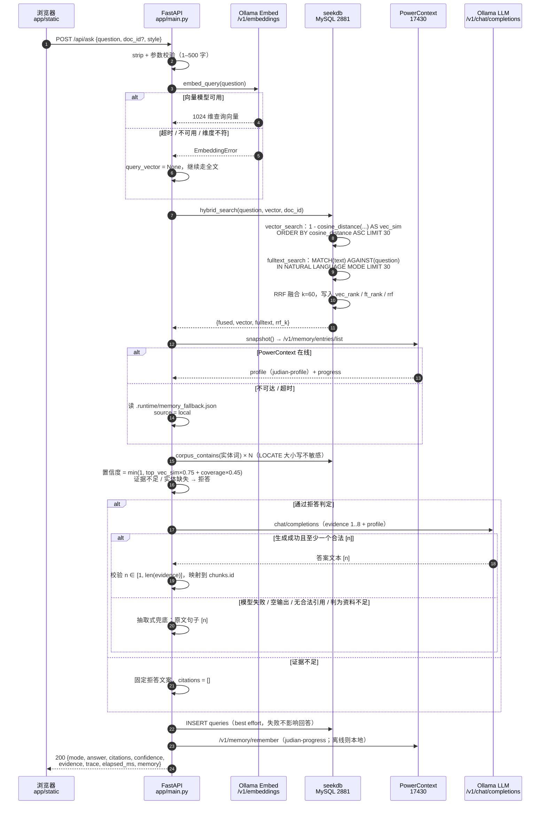

# 01 · 表结构与一次问答的时序

> 任务卡 01 交付物：先给设计，不写实现代码。
> 依据：`README.md`、`docs/技术说明.md`，以及现有实现 `app/db.py`、`app/main.py`、`app/embed.py`、`app/llm.py`、`app/memory.py`。
> 本文中的 DDL 与 `app/db.py` 里的 `DOCUMENTS_DDL` / `CHUNKS_DDL` / `QUERIES_DDL` / `NOTES_DDL` 逐字对应；`{dim}` 在运行时由 `Settings.embed_dim`（默认 1024）填充。

---

## 0. 模块边界

| 模块 | 位置 | 负责 | 不负责 |
| --- | --- | --- | --- |
| HTTP / 编排 | `app/main.py` | 参数校验、状态码、并行健康检查、把各组件串成一次问答、记录耗时 | 不做检索算法，不拼 SQL，不解析文档 |
| 解析与分块 | `app/ingest.py` | Markdown/HTML/TXT/PDF 解析、标题面包屑、按节打包（目标 760 / 上限 1050 / 重叠 110 字符）、SHA-256 | 不碰数据库，不调用模型 |
| 向量化 | `app/embed.py` | Ollama OpenAI 兼容 `/v1/embeddings`、批量、磁盘缓存、维度校验 | 不写入 seekdb |
| 检索与持久化 | `app/db.py` | 四张表 DDL、`cosine_distance` 向量召回、`MATCH ... AGAINST` 全文召回、RRF 融合、问答/笔记读写 | 不做拒答判断，不生成答案 |
| 答案与引用 | `app/llm.py` | 置信度、拒答、生成、引用校验、抽取式兜底、`chunk_id` 映射 | 不直接连数据库；语料实体检查通过回调注入 |
| 记忆 | `app/memory.py` | PowerContext Scope / `remember` / `entries/list`，离线降级到本地 JSON | 不影响检索与答案正确性 |
| 灌库编排 | `app/pipeline.py` | checksum 跳过、批量向量化、事务内替换文档、上传落盘 | 不定义表结构 |

边界原则：**seekdb 是唯一的事实来源，Ollama 只提供向量与措辞，PowerContext 只提供偏好与进度，任何一方离线都不能让引用失去出处。**

---

## 1. 一次提问从 HTTP 到答案的时序

### 1.1 时序图



### 1.2 调用点与失败分支

| # | 步骤 | 代码位置 | 外部依赖 | 失败时的行为 |
| --- | --- | --- | --- | --- |
| 1 | 接收 `POST /api/ask` | `app/main.py:202` | — | 空问题 400；超长/类型错误 422 |
| 2 | 查询向量化 | `app/embed.py:146` → `_post_batch` | Ollama `/v1/embeddings` | 捕获 `EmbeddingError`，`embedding.used=false`，降级为纯全文检索 |
| 3 | 混合召回 | `app/db.py:391` `hybrid_search` | seekdb | 连接失败抛 `DBUnavailable` → HTTP 503 |
| 4 | 向量召回 | `app/db.py:354`，SQL 在 `app/db.py:77` | seekdb `cosine_distance` | 同上；`doc_id` 过滤时只在该文档内召回 |
| 5 | 全文召回 | `app/db.py:373`，SQL 在 `app/db.py:88` | seekdb `MATCH ... AGAINST` + ik | 同上；无命中返回空列表，不报错 |
| 6 | RRF 融合 | `app/db.py:404-435` | 纯 Python | 单路为空时另一路照常保留 |
| 7 | 读取记忆 | `app/memory.py:341` `snapshot` | PowerContext | 任何异常 → 本地 JSON，`source=local`，答案不受影响 |
| 8 | 实体存在性检查 | `app/db.py:326` `corpus_contains` | seekdb `LOCATE` | 查询异常时跳过检查（`break`），不因检查失败误拒答 |
| 9 | 置信度与拒答 | `app/llm.py:454-503` | 纯 Python | 无证据 / 拉丁实体缺失 / 低相似度且低覆盖 → `insufficient` |
| 10 | 生成答案 | `app/llm.py:86` `_post` | Ollama `/v1/chat/completions` | `LLMError` → 抽取式兜底，`llm_error` 随响应返回 |
| 11 | 引用校验 | `app/llm.py:233` `parse_citations`、`app/llm.py:246` `_clean_citations` | 纯 Python | 无合法引用 → 整段改为抽取式；越界编号从文本中删除 |
| 12 | 记录问答 | `app/db.py:438` `log_query` | seekdb | 静默失败（返回 `None`），不影响本次回答 |
| 13 | 记录进度 | `app/memory.py:312` `record_progress` | PowerContext | 失败时 `memory.source=local`，不影响回答 |
| 14 | 组装响应 | `app/main.py:267-285` | — | 响应中 `n` 是展示编号，`chunk_id` 是唯一出处 |

### 1.3 并发与事务口径

- HTTP 处理函数是同步 `def`，由 FastAPI 放进线程池执行；单次问答内除“记忆读取”外没有额外并行。
- 数据库连接是“每次操作一条连接”，`autocommit=True`；检索、日志、笔记互不共享事务。
- 只有三类写入使用显式事务：`replace_document`、`delete_document`、`reset_corpus`。重灌时先 `DELETE chunks` 再批量插入，失败整体回滚，不会留下半篇文档。
- `/api/health` 才使用 4 路线程池并行探测 seekdb / 向量 / 生成 / 记忆，避免串行超时。

### 1.4 降级矩阵

| 故障 | 用户看到 | 引用是否仍可信 |
| --- | --- | --- |
| Ollama embeddings 离线 | 仍可回答，`embedding.used=false`；仅全文召回 | 是，引用仍来自 `chunks.id` |
| Ollama LLM 离线 / 超时 | `mode=extractive`，原文摘录 + `[n]` | 是，摘录句直接来自召回片段 |
| LLM 输出没有合法引用 | `mode=extractive`，原因写明“模型未给出合法引用” | 是 |
| seekdb 离线 | `/api/ask` 返回 503；资料库/历史/笔记为空并附错误 | 不产生答案，因此不存在无出处引用 |
| PowerContext 离线 | 回答不受影响，记忆显示“本地” | 是；偏好只影响措辞，不作为事实依据 |
| 资料外问题 | `mode=insufficient`，固定拒答文案，`citations=[]` | 不适用 |

---

## 2. 四张表

### 2.1 `documents`

```sql
CREATE TABLE IF NOT EXISTS documents (
  id BIGINT AUTO_INCREMENT PRIMARY KEY,
  title VARCHAR(200) NOT NULL,
  source VARCHAR(512) NOT NULL,
  kind VARCHAR(16) NOT NULL,
  pages INT NULL,
  chars INT NOT NULL DEFAULT 0,
  checksum VARCHAR(64) NOT NULL DEFAULT '',
  created_at DATETIME DEFAULT CURRENT_TIMESTAMP,
  UNIQUE KEY uk_doc_source (source(191))
) ORGANIZATION = HEAP
```

| 字段 | 类型 | 约束 | 为什么 |
| --- | --- | --- | --- |
| `id` | `BIGINT` | 自增主键 | `chunks.doc_id` 的引用目标；与 `source` 解耦，路径改名不牵连片段 |
| `title` | `VARCHAR(200)` | 非空 | 展示名与提示词里的《书名》；来源优先级：显式标题 → frontmatter `title` → manifest → 文件名 |
| `source` | `VARCHAR(512)` | 非空，唯一（前缀 191） | 稳定业务键：`seekdb-dev/build-and-run.md` 或 `uploads/<safe>`；重灌按它 upsert，而不是按标题 |
| `kind` | `VARCHAR(16)` | 非空 | `markdown` / `text` / `html` / `pdf`；前端图标、统计与调试 |
| `pages` | `INT` | 可空 | 仅 PDF 有页数；其他格式为 `NULL`，避免用 0 冒充“0 页” |
| `chars` | `INT` | 默认 0 | 正文长度，用于资料库统计；与 `SUM(LENGTH(chunk.text))` 不同，后者含重叠 |
| `checksum` | `VARCHAR(64)` | 默认 `''` | 原始字节的 SHA-256；未变化且已有片段时跳过重灌，省下全部 embedding 调用 |
| `created_at` | `DATETIME` | 默认当前时间 | 首次入库时间；覆盖导入只更新正文元数据，不重置该时间 |

索引取舍：

- `uk_doc_source (source(191))`：唯一约束保证“同一来源只有一篇文档”，是 `replace_document` 先查后插的依据。用前缀索引控制索引宽度，并兼容 767 字节的旧索引限制（`191 × 4 = 764`）。代价是：若两个 `source` 前 191 个字符完全相同会被判重。当前语料相对路径和上传文件名都远短于 191 字符；将来若允许超长路径，应改为“`source_hash` 唯一 + 完整 `source` 普通列”。
- 没有为 `title` 建索引：资料库列表按 `id` 排序，数据量为个位数到百级，全表读可接受。

### 2.2 `chunks`

```sql
CREATE TABLE IF NOT EXISTS chunks (
  id BIGINT AUTO_INCREMENT PRIMARY KEY,
  doc_id BIGINT NOT NULL,
  ordinal INT NOT NULL DEFAULT 0,
  heading VARCHAR(255) NOT NULL DEFAULT '',
  page INT NULL,
  text TEXT NOT NULL,
  embedding VECTOR({dim}) NOT NULL,
  created_at DATETIME DEFAULT CURRENT_TIMESTAMP,
  INDEX idx_chunk_doc (doc_id, ordinal),
  FULLTEXT INDEX ft_chunk (text) WITH PARSER ik,
  VECTOR INDEX vi_chunk (embedding) WITH (DISTANCE=cosine, TYPE=hnsw, LIB=vsag)
) ORGANIZATION = HEAP
```

| 字段 | 类型 | 约束 | 为什么 |
| --- | --- | --- | --- |
| `id` | `BIGINT` | 自增主键 | **引用的最终落点**：`citations[].chunk_id` 就是它；展示编号 `n` 只是本次证据列表的下标 |
| `doc_id` | `BIGINT` | 非空 | 归属文档；删除/重灌按它级联。DDL 不声明外键，见 2.5 |
| `ordinal` | `INT` | 默认 0 | 文档内顺序，重灌后保持稳定；与 `doc_id` 组成定位索引 |
| `heading` | `VARCHAR(255)` | 默认 `''` | 标题面包屑（如 `编译 › Release`），写进提示词帮助模型定位；超长截断 |
| `page` | `INT` | 可空 | PDF 页码；其他格式为 `NULL` |
| `text` | `TEXT` | 非空 | 原文片段（正文 + 代码围栏）。分块目标 760、上限 1050 字符，远小于 `TEXT` 的 64KB |
| `embedding` | `VECTOR(1024)` | 非空 | 语义召回列。维度是**物理列类型**，建表后不能靠改环境变量改变 |
| `created_at` | `DATETIME` | 默认当前时间 | 便于排查“这篇是什么时候灌进来的” |

索引取舍：

- `idx_chunk_doc (doc_id, ordinal)`：覆盖三类高频操作——按文档删除片段、按文档统计片段数、按顺序回放片段。它不是唯一索引。
- `FULLTEXT INDEX ft_chunk (text) WITH PARSER ik`：中文没有空格，必须用 `ik` 分词器；查询直接传原问题，由分词器切词，应用层不预切。
- `VECTOR INDEX vi_chunk (embedding) WITH (DISTANCE=cosine, TYPE=hnsw, LIB=vsag)`：HNSW 近似最近邻，距离函数与 `cosine_distance` 一致。SQL 中用 `1 - cosine_distance(...)` 转成相似度，排序仍按距离升序。
- 不设 `UNIQUE (doc_id, ordinal)`：`ordinal` 由 `ingest.py` 统一 `enumerate` 生成，重灌前会先删除该文档全部片段；加唯一约束只会在批量插入顺序或重试时制造额外失败，收益很低。
- `text` 上的 `LOCATE` 实体检查没有索引，是全表扫描。当前 135 个片段可接受；语料上千后应改为独立的词项表或缓存。

### 2.3 `queries`

```sql
CREATE TABLE IF NOT EXISTS queries (
  id BIGINT AUTO_INCREMENT PRIMARY KEY,
  user_id VARCHAR(64) NOT NULL DEFAULT 'demo',
  question TEXT NOT NULL,
  answer MEDIUMTEXT,
  mode VARCHAR(16) NOT NULL DEFAULT '',
  confidence DOUBLE NOT NULL DEFAULT 0,
  citations JSON,
  evidence JSON,
  elapsed_ms INT NOT NULL DEFAULT 0,
  created_at DATETIME DEFAULT CURRENT_TIMESTAMP,
  INDEX idx_queries_user_time (user_id, created_at)
) ORGANIZATION = HEAP
```

| 字段 | 类型 | 约束 | 为什么 |
| --- | --- | --- | --- |
| `id` | `BIGINT` | 自增主键 | 历史记录排序与翻页 |
| `user_id` | `VARCHAR(64)` | 默认 `demo` | 为多用户预留隔离位；单机默认 `demo`，所有查询都带该条件 |
| `question` | `TEXT` | 非空 | 原始问题（已 `strip`，最长 500 字） |
| `answer` | `MEDIUMTEXT` | 可空 | 最终展示文本；拒答时是固定文案，抽取式时是摘录 |
| `mode` | `VARCHAR(16)` | 默认 `''` | `llm` / `extractive` / `insufficient`；前端徽标与评测统计都依赖它 |
| `confidence` | `DOUBLE` | 默认 0 | `min(1, top_vec_sim×0.75 + coverage×0.45)` 的结果；用于观察拒答边界 |
| `citations` | `JSON` | 可空 | 完整引用快照：`n`、`chunk_id`、标题、路径、heading、页码、文本、排名、分数 |
| `evidence` | `JSON` | 可空 | 证据摘要，**不含正文**，只留定位与打分字段，控制单行体积 |
| `elapsed_ms` | `INT` | 默认 0 | 端到端耗时，用于回归对比 |
| `created_at` | `DATETIME` | 默认当前时间 | 历史记录时间 |

索引取舍：

- `idx_queries_user_time (user_id, created_at)`：先按用户缩小范围，再按时间组织；当前查询用 `ORDER BY id DESC`，主键即可保证倒序，二级索引主要承担用户过滤。
- `citations` / `evidence` 用 `JSON` 而不是拆表：它们是**当时的快照**，不应随 `chunks` 重灌而变化；拆表反而会产生“引用指向已删除片段”的外键冲突。

### 2.4 `notes`

```sql
CREATE TABLE IF NOT EXISTS notes (
  id BIGINT AUTO_INCREMENT PRIMARY KEY,
  user_id VARCHAR(64) NOT NULL DEFAULT 'demo',
  question TEXT NOT NULL,
  answer MEDIUMTEXT,
  citations JSON,
  created_at DATETIME DEFAULT CURRENT_TIMESTAMP,
  INDEX idx_notes_user_time (user_id, created_at)
) ORGANIZATION = HEAP
```

| 字段 | 类型 | 约束 | 为什么 |
| --- | --- | --- | --- |
| `id` | `BIGINT` | 自增主键 | 笔记倒序列表 |
| `user_id` | `VARCHAR(64)` | 默认 `demo` | 与 `queries` 一致的用户维度 |
| `question` | `TEXT` | 非空 | 笔记标题 |
| `answer` | `MEDIUMTEXT` | 可空 | 用户保存的答案全文 |
| `citations` | `JSON` | 可空 | 只保留带 `chunk_id` 的引用；写入前由 `/api/notes` 过滤掉无出处的条目 |
| `created_at` | `DATETIME` | 默认当前时间 | 笔记时间 |

设计取舍：

- `notes` 不存 `mode` / `confidence` / `elapsed_ms`：笔记是“用户主动收藏的结论”，不是一次检索审计；保留这些字段会让笔记看起来像评测记录。
- 笔记不做去重：同一问答可以保存多次，用户可能想保留不同措辞或不同上下文。
- `INDEX idx_notes_user_time` 与 `queries` 同构，便于两张表用同一套列表逻辑。

### 2.5 表间关系与一致性核对

- `chunks.doc_id → documents.id` 是逻辑外键，DDL 中**故意不声明** `FOREIGN KEY`：四张表都显式 `ORGANIZATION = HEAP`，本项目把级联放在应用层事务里，避免重灌时外键检查拖慢批量插入。
- 级联规则：
  - `replace_document`：同一事务内 `DELETE chunks WHERE doc_id=?`，更新 `documents`，再 `executemany` 插入新片段；失败回滚。
  - `delete_document`：同一事务内先删片段，再删文档。
  - `reset_corpus`：同一事务内先清空 `chunks`，再清空 `documents`；**不动** `queries` / `notes`。
- `queries.citations` / `notes.citations` 中的 `chunk_id` 是历史快照，不设外键：片段被重灌后编号会变，但历史答案仍应保留当时的出处信息。

与 `app/db.py` 的逐项核对：

| 核对项 | 代码位置 | 结论 |
| --- | --- | --- |
| 四段 DDL 常量 | `app/db.py:19-75` | 与本文字段、类型、默认值、索引逐字一致 |
| 建表顺序 | `app/db.py:152-162` | `documents → chunks → queries → notes` |
| 向量维度注入 | `app/db.py:155` | `CHUNKS_DDL.format(dim=settings.embed_dim)`，默认 1024 |
| 文档 upsert | `app/db.py:197-278` | 按 `source` 查 `FOR UPDATE`，有则删片段后更新，无则插入 |
| 片段写入 | `app/db.py:256-264` | 字段顺序 `doc_id, ordinal, heading, page, text, embedding` |
| 历史写入 | `app/db.py:438-470` | 字段与 `queries` DDL 一致；JSON 用 `ensure_ascii=False` |
| 笔记写入 | `app/db.py:493-509` | 字段与 `notes` DDL 一致；只写入带 `chunk_id` 的引用 |
| 表组织方式 | 四段 DDL 末尾 | 均为 `ORGANIZATION = HEAP` |

两个已知边界（设计层面，不在本卡改代码）：

1. `ensure_schema` 使用 `CREATE TABLE IF NOT EXISTS`。如果只改 `JUDIAN_EMBED_DIM` 而不删表，`chunks.embedding` 仍是旧维度；`seed.py --reset` 只清行、不重建表。更换 embedding 模型维度时必须先 `DROP TABLE chunks`（或做一次显式迁移）。
2. `uk_doc_source` 是前缀唯一索引，比较的是前 191 个字符；当前路径长度远低于该阈值，暂无实际影响。

---

## 3. 三个最容易失败的点

### 3.1 向量维度：配置、模型、表结构三处必须同时一致

**现象**

- 写入时报维度不匹配或向量字面量非法；
- 检索时不报错但永远召回 0 条；
- 换了 embedding 模型后，旧缓存向量仍被复用，结果“能用但明显变差”。

**根因**

维度同时存在于三个地方：Ollama 返回的数组长度、`Settings.embed_dim`、`chunks.embedding VECTOR(n)` 的物理列类型。任何一处变化而另外两处不变，就会在写入或召回时断裂。

**现有防线**

- `app/embed.py:91-95`：每批返回后逐个检查 `len(vector) == self.dim`，不匹配立即抛 `EmbeddingError`，错误信息直接给出“当前维度 / 配置维度 / 重灌建议”。
- `app/embed.py:46-54`：磁盘缓存按 `model` 隔离，并且只加载长度等于 `dim` 的向量；旧模型或旧维度的缓存不会被静默复用。
- `app/pipeline.py:78-81`：先完成全部向量化，再调用 `replace_document`；维度错误会在写库前失败，旧文档保持完整。
- `app/db.py:155`：建表时用同一个 `settings.embed_dim` 填充 `VECTOR({dim})`。

**对应测试**

| 测试 | 覆盖 |
| --- | --- |
| `tests/test_memory.py::test_embedder_uses_disk_cache_and_batches` | 以 `embed_dim=3` 跑通批量、缓存与二次命中，证明维度校验不会误伤正常路径 |
| `tests/test_api.py::test_ask_falls_back_when_embedding_fails` | 向量化失败时问答不中断，响应标记 `embedding.used=false` |

**缺口（建议补，未实现）**

- 没有“返回 4 维、配置 3 维 → 必须抛 `EmbeddingError`”的直接单测。
- 没有“旧模型/旧维度缓存必须被忽略”的缓存污染测试。
- 没有 live 测试验证“改维度后旧表写入会失败、且旧文档未被破坏”；这需要 seekdb。

### 3.2 中文分词：全文召回可能整条失效，但不能拖垮答案

**现象**

- `MATCH ... AGAINST` 对中文问句返回空；
- 技术词（`memory_budget`、`build_release`、`seekdb`）被切碎或不被识别；
- 小语料下常见词被自然语言模式当作高频词忽略，导致“明明有原文却召回不到”。

**根因**

中文没有空格，全文索引必须依赖分词器；`ik` 的词典、停用词与 MySQL 兼容的自然语言模式（可能忽略停用词和出现在大量行中的词）共同决定命中。问句越长、越口语化，越容易和原文用词错位。

**现有防线**

- `FULLTEXT INDEX ft_chunk (text) WITH PARSER ik`：建表即绑定中文分词器，不依赖应用层切词。
- 双路召回：向量路不依赖分词，全文路不依赖语义；RRF 让单路命中也能进入证据列表。
- `app/llm.py:33-56`：`lexical_coverage` 用**字符二元组**计算词面覆盖，完全独立于 seekdb 分词器，用于置信度与抽取式排序。
- `app/llm.py:19-24`：中文疑问词停用表（“什么 / 怎么 / 为什么 / 如何 …”）避免“怎么”这类高频二元组抬高覆盖度。
- `app/llm.py:59-69` + `app/db.py:326-336`：拉丁实体单独抽取，用 `LOCATE(LOWER(...))` 做存在性检查；这类词不依赖全文分词。
- 拒答条件要求“向量相似度低 **且** 词面覆盖低”，单路失效不会单独触发误拒答。

**对应测试**

| 测试 | 覆盖 |
| --- | --- |
| `tests/test_core.py::test_lexical_coverage_handles_chinese_bigrams` | 中文问句对中文原文的二元组覆盖大于 0 |
| `tests/test_core.py::test_hybrid_search_rrf_merges_ranks` | 两路排名不同时，RRF 能正确融合并保留单路字段 |
| `tests/test_core.py::test_missing_latin_entity_refuses_even_with_similar_chunks` | 中文语义相近但拉丁实体不存在时仍拒答 |
| `tests/test_api.py::test_ask_rejects_out_of_corpus_entity` | 端到端验证实体缺失拒答与空引用 |

**缺口（建议补，未实现）**

- 没有“全文路为空、向量路有结果”的融合单测（当前融合测试两路都有数据）。
- 没有 live 测试直接验证 `ik` 对中文问句的召回；这类断言必须连 seekdb，离线只能 SKIP。
- `ik` 词典版本、`innodb_ft_min_token_size` 一类参数未在代码中显式固定，部署环境差异需要在 `verify.py --require-db` 的 live 检查里暴露。

### 3.3 引用越界：模型编号必须被裁剪，最终只能落到 `chunks.id`

**现象**

- 模型输出 `[9]`，但本次只有 8 条证据；
- 模型输出 `[0]`、重复编号，或整段没有任何编号；
- 前端展示的 `n` 与数据库主键混淆，导致“看起来有引用，实际点不到原文”。

**根因**

`[n]` 是**提示词内的局部编号**，不是数据库主键；模型可以自由生成任意数字。若不校验，越界编号会变成看似可信的伪引用。

**现有防线**

- `app/llm.py:233-243` `parse_citations`：只接受 `1 ≤ n ≤ len(evidence)`，去重并单独收集非法编号。
- `app/llm.py:246-253` `_clean_citations`：把所有越界编号从答案文本中删除，避免正文残留伪引用。
- `app/llm.py:525-547`：没有任何合法引用时，整段答案改为抽取式；有合法引用时，`citations` 通过 `_citation(evidence[n-1], n, True)` 生成，`chunk_id` 直接取自证据行的数据库 `id`。
- `app/llm.py:351-408` 抽取式兜底：只引用被选中的证据句，编号仍由证据下标生成，最终同样映射到 `chunk_id`。
- `app/main.py:344-357`：保存笔记前再次过滤，缺 `chunk_id` 的引用直接丢弃。
- 证据不足 / 实体缺失 / 模型判定资料不足：`citations=[]`，不产生任何“无出处引用”。

**对应测试**

| 测试 | 覆盖 |
| --- | --- |
| `tests/test_core.py::test_parse_citations_dedupes_and_rejects_out_of_range` | `[1]、[9]、[1]、[2]` → 合法 `[1,2]`，非法 `[9]` |
| `tests/test_core.py::test_clean_citations_removes_out_of_range` | 越界 `[9]` 从正文删除 |
| `tests/test_core.py::test_llm_out_of_range_citation_is_cleaned_and_falls_back` | 只有 `[9]` 时整段回退为抽取式 |
| `tests/test_core.py::test_llm_without_valid_citation_falls_back_to_extractive` | 完全没有编号时回退 |
| `tests/test_core.py::test_llm_answer_with_valid_citation_is_kept` | 合法 `[1]` 被保留，`chunk_id` 来自证据行 |
| `tests/test_api.py::test_ask_returns_citation_tied_to_chunk` | HTTP 响应里 `citations[0].chunk_id == 42`，`n == 1` |
| `tests/test_api.py::test_note_keeps_only_citations_with_chunk_id` | 保存笔记时剔除无 `chunk_id` 的引用 |

**已知边界**

- 引用正则是 `\[(\d{1,2})\]`，只识别 1–2 位数字。`[123]` 这类三位括号不会被当作引用，若同一答案里还有合法 `[1]`，`[123]` 会作为普通文本保留。这是为了避免误伤 `[2026]`、版本号一类的正常写法；若要把三位编号也视为越界引用，需要同时调整 `_CITATION` 与测试口径。
- 单测使用的是假数据库，只证明“编号映射到证据行的 `id`”；`chunk_id` 在真实库中是否仍存在，目前由 live 评测人工观察，尚未做成强制断言。建议在 `scripts/eval.py` 增加一次 `fetch_chunks(citation.chunk_id)` 的存在性校验。

---

## 4. 验收对照

- [x] `docs/qoder/01-design.md` 存在；
- [x] 第 1 节包含 HTTP → 答案的完整时序，并标明 seekdb、Ollama embeddings、Ollama chat、PowerContext 的调用点与降级行为；
- [x] 第 2 节包含 `documents` / `chunks` / `queries` / `notes` 的字段、索引与设计理由；
- [x] 第 2.5 节逐项核对 `app/db.py` 的 DDL 与写入路径；
- [x] 第 3 节列出向量维度、中文分词、引用越界三个失败点，并区分“已有测试”与“待补测试”；
- [x] Qoder 会话截图：`docs/evidence/screens/qoder-01.png`（2026-10-28 截取，2877×1775）。

## 5. 关键常量（便于与实现对照）

| 常量 | 值 | 位置 |
| --- | --- | --- |
| 向量维度 | 1024（`qwen3-embedding:0.6b`） | `app/config.py` `embed_dim` |
| 单路召回 | 30 | `recall_limit` |
| 进入提示词的证据数 | 8 | `evidence_top_n` |
| RRF 常数 | 60 | `rrf_k` |
| 拒答阈值 | `top_vec_sim < 0.28` 且 `coverage < 0.20` | `min_vector_sim` / `min_coverage` |
| 置信度 | `min(1, top_vec_sim×0.75 + coverage×0.45)` | `app/llm.py:72-73` |
| 分块 | 目标 760 / 上限 1050 / 重叠 110 字符 | `app/ingest.py:11-13` |
| 上传上限 | 20MB | `max_upload_mb` |
| 单条记忆上限 | 8KB | `app/memory.py:260-262` |
