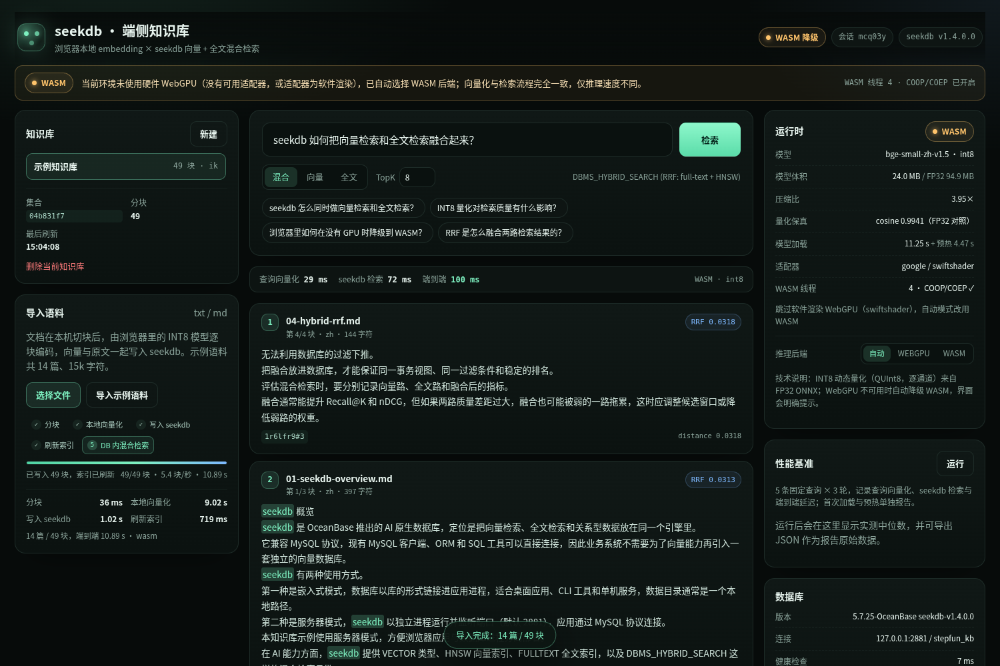

# seekdb × 端侧 AI 推理：迷你知识库

> StepFun（阶跃星辰）赛道作品：**在浏览器本地完成 embedding，用 seekdb 完成向量 + 全文混合检索**。
> 无云端推理 API，无服务端预算向量，排名完全由 seekdb 的 `DBMS_HYBRID_SEARCH` 产生。



## 1. 它做了什么

一条完整的端侧知识库链路：

```text
txt / md 文件
   │  ① 服务端确定性分块（420 字 / 80 字重叠，内容哈希做幂等 ID）
   ▼
浏览器 Web Worker
   │  ② bge-small-zh-v1.5 INT8 模型本地推理（WebGPU 优先 → WASM 自动降级）
   │     每批 8–16 块，进度条实时反馈
   ▼
Node API（Express + seekdb-js）
   │  ③ 批量 upsert 向量 / 原文 / 元数据 → refresh_index()
   ▼
seekdb（本机 server 模式，2881）
   │  ④ 一次 DBMS_HYBRID_SEARCH：FULLTEXT(IK) + HNSW(cosine) → RRF 融合
   ▼
浏览器展示排序结果、原文、分阶段耗时与数据库端 SQL
```

对赛题验收点的覆盖：

| 验收要求 | 实现 | 可检查的证据 |
|---|---|---|
| 完整流程 | 导入 → 本地向量化 → 写 seekdb → 查询 → 排序结果 | 首页即可完成；`evidence/screenshots/` |
| 本地推理 | Transformers.js + ONNX Runtime Web，在 Web Worker 中执行 | 无任何云端 API；请求只打到本机 `/api`、`/models` |
| 模型量化 | 自行把 FP32 ONNX 量化为 INT8（QUInt8，逐通道） | `scripts/quantize.py`、`evidence/model-quantization.json` |
| 后端与降级 | WebGPU 优先；不可用/软件渲染时自动 WASM，界面明确提示 | 顶部徽章、黄色提示条、后端手动切换 |
| seekdb 数据层 | 向量、原文、元数据都在 seekdb；混合检索在库内完成 | `evidence/schema.txt`、结果页「查看 SQL」 |
| 状态与刷新 | 增量导入、幂等 upsert、刷新后立即可查、集合/会话隔离 | 左侧知识库面板、`lastRefresh`、导入耗时拆分 |
| 可复现性 | 一条命令启动；量化/评测/基准脚本齐全 | 本文 §4、§5 |

## 2. 快速开始

### 前置条件

- Node.js ≥ 20（开发用 24.21）
- 一个可连接的 seekdb（server 模式，默认 `127.0.0.1:2881`，用户 `root`、空密码）
- 浏览器：Chrome / Edge 最新版

### 启动

```bash
cd stepfun
npm install            # .npmrc 已设置 legacy-peer-deps / ignore-scripts
npm run build          # 构建前端（模型文件已随仓库提供）
npm start              # http://127.0.0.1:3000
```

首次打开请点击 **「导入示例语料」**（14 篇 / 49 块），等待向量化完成即可检索。
也可以先跑一遍数据层自检：`npm run smoke`（8 项，检查建库/写入/刷新/混合检索/DDL）。

开发模式（Vite HMR + API 双进程）：

```bash
npm run dev            # http://127.0.0.1:5173
```

### 配置

| 环境变量 | 默认值 | 说明 |
|---|---|---|
| `PORT` | `3000` | Web 服务端口 |
| `SEEKDB_HOST` / `SEEKDB_PORT` | `127.0.0.1` / `2881` | seekdb 连接 |
| `SEEKDB_USER` / `SEEKDB_PASSWORD` | `root` / 空 | 账号 |
| `SEEKDB_DATABASE` | `stepfun_kb` | 数据库名（首次启动自动创建） |
| `EMBED_MODEL` | `bge-small-zh-v1.5` | 前端模型目录名 |

后端可在界面上切换：**自动 / WebGPU / WASM**；也支持 URL 参数 `?backend=wasm`、`?backend=webgpu`。

## 3. 实现要点

### 3.1 端侧推理与降级

- 运行时：`@huggingface/transformers@3.8.1`（内部 ONNX Runtime Web 1.22），跑在 Web Worker 里，主线程不卡顿。
- 后端选择链：WebGPU → WASM。自动模式会跳过 SwiftShader / llvmpipe 这类**软件渲染**的 WebGPU 适配器（实测比 WASM 慢 7 倍以上），并在界面说明原因；`?backend=webgpu` 可强制验证 WebGPU 路径。
- WASM 多线程依赖跨源隔离：服务端与 Vite 都发送 `COOP: same-origin` / `COEP: require-corp`，界面显示 `COOP/COEP ✓` 与线程数。
- 模型与分词器全部本地静态资源（`web/public/models/`），运行时不访问 Hugging Face。

### 3.2 模型量化

| 项目 | 数值 |
|---|---|
| 基座 | `BAAI/bge-small-zh-v1.5`（ONNX 转换版：`Xenova/bge-small-zh-v1.5`） |
| 维度 / 池化 | 512 / CLS + L2 normalize |
| 量化方式 | ONNX Runtime `quantize_dynamic`，权重 **QUInt8**，**逐通道**，激活动态 |
| FP32 体积 | 94.85 MB（94,851,877 B） |
| INT8 体积 | 24.01 MB（24,014,955 B） |
| 压缩比 | **3.95×** |
| 数值保真 | 6 句对照：余弦均值 **0.9941**、最小 0.9929、最大绝对误差 0.0178 |
| 检索质量 | 见下表，20 条标注查询 / 49 块 / 14 篇 |

量化前后检索质量（文档级，Recall / nDCG / MRR）：

| 模型 | R@1 | R@5 | R@10 | nDCG@5 | nDCG@10 | MRR |
|---|---:|---:|---:|---:|---:|---:|
| FP32 | 0.775 | 0.925 | 1.000 | 0.906 | 0.934 | 0.975 |
| INT8 | 0.775 | 0.925 | 1.000 | 0.909 | 0.937 | 0.975 |

> 差异在评测集噪声范围内：Recall 与 MRR 完全一致，nDCG 反而略高。原始数据见 `evidence/quality-report.json`。
> 另做了查询指令前缀消融：BGE 官方建议的「为这个句子生成表示…」前缀在自然语言问句集上使 nDCG@5 从 0.906 降到 0.879，因此默认不加前缀（配置保留，可一键开启）。

### 3.3 seekdb 数据层

集合由 seekdb-js 创建，实际表结构（`SHOW CREATE TABLE` 实测，见 `evidence/schema.txt`）：

```sql
CREATE TABLE `c$v2$...` (
  `_id` varbinary(512) NOT NULL,
  `document` string DEFAULT NULL,
  `embedding` VECTOR(512) DEFAULT NULL,
  `metadata` json DEFAULT NULL,
  PRIMARY KEY (`_id`),
  FULLTEXT KEY `idx_fts` (`document`) WITH PARSER ik PARSER_PROPERTIES=(ik_mode="smart") BLOCK_SIZE 16384,
  VECTOR KEY `idx_vec` (`embedding`) WITH (DISTANCE=COSINE, TYPE=HNSW, LIB=VSAG, ...)
);
```

混合检索只有一次调用，融合在数据库内完成：

```js
collection.hybridSearch({
  query: { whereDocument: { $contains: cleanedQuery }, nResults: window },
  knn:   { queryEmbeddings: queryVector, nResults: window },
  rank:  { rrf: { rankWindowSize: window, rankConstant: 60 } },
  nResults: topK,
  include: ["documents", "metadatas", "distances"],
});
```

- `window = max(60, topK × 8)`，保证两路都有足够候选进入 RRF。
- 全文查询先做特殊字符清洗，避免 `query_string` 语法错误。
- 页面「查看数据库内执行的 SQL」会展示实际执行的三条语句：`SET @search_parm`、`DBMS_HYBRID_SEARCH.GET_SQL`、融合查询本身。

增量与状态：

- 分块 ID = `hash(文档名 + 内容) # 序号`，重复导入走 `upsert`，不会产生重复数据。
- 每次导入提交后调用一次 `refresh_index()`，界面分别展示写入耗时与刷新耗时，刷新完成后才提示可检索。
- 每个知识库一个集合，会话记住当前集合；集合被删除时自动回退，异步导入始终写回开始时的集合。

### 3.4 性能

固定条件：同一台机器（Intel Core Ultra 7 258V / 4 核 / 9.7GB）、Edge 156 headless、同一语料（14 篇 / 49 块 / 15,098 字符）、同一查询集（5 条 × 3 轮）、INT8、batch 8–16。

| 配置 | 模型体积 | 冷 → 热加载 | 49 块向量化 | 查询向量化 P50 | seekdb 检索 P50 | 端到端 P50 | 质量 R@5 / nDCG@5 |
|---|---:|---:|---:|---:|---:|---:|---:|
| FP32 + WASM（基线） | 94.85 MB | 41.8 s → 5.0 s | 13.39 s（3.66 块/秒） | 94.2 ms | 54.7 ms | 158.6 ms | 0.925 / 0.906 |
| **INT8 + WASM（自动模式采用）** | **24.01 MB** | **20.0 s → 1.25 s** | **10.87 s（4.51 块/秒）** | **38.1 ms** | **53.7 ms** | **89.6 ms** | **0.925 / 0.909** |
| INT8 + WebGPU（SwiftShader 软件渲染） | 24.01 MB | 24.5 s → 1.30 s | 156.15 s（0.31 块/秒） | 507.6 ms | 19.6 ms | 526.8 ms | 同一 INT8 权重 |

查询与检索为 5 条查询 × 3 轮的中位数；写入 seekdb 约 0.99 s、刷新索引约 0.55 s（49 块）。完整方法、逐项原始数据与讨论见 [`docs/性能与质量报告.md`](docs/性能与质量报告.md)。

> 本机 WebGPU 适配器是 **SwiftShader（软件渲染）**，因此 WebGPU 数字不代表真实 GPU 性能；有独立显卡/核显的机器请运行 `npm run bench` 重新采集。自动模式在这台机器上会选择 WASM，正是基于这一实测。

分阶段计时口径：查询向量化 = Worker 内推理；seekdb 检索 = 服务端一次 `hybridSearch` 往返（含网络与 JSON）；端到端 = 从点击检索到结果可渲染。

批处理 A/B（同一页面、同一模型、24 块，交替两轮）：固定 batch=8 为 2.81 s（8.54 块/秒），长度感知分批为 3.36 s（7.15 块/秒）。在本语料上差异被机器噪声淹没，**不宣称加速**；保留该策略是为了在长度差异大的文档上减少 padding。见 `evidence/batch-ab.json`。

## 4. 复现实验

### 4.1 量化与数值校验

```bash
python3 -m venv .venv && .venv/bin/pip install onnxruntime onnx numpy tokenizers
npm run model:fetch          # 从 ModelScope 镜像下载 FP32 ONNX（默认；MODEL_MIRROR=hf 可切换）
npm run model:quantize       # -> evidence/model-quantization.json + .models/.../model_int8_ours.onnx
cp .models/bge-small-zh-v1.5/onnx/model_int8_ours.onnx web/public/models/bge-small-zh-v1.5/onnx/model_int8.onnx
```

### 4.2 检索质量

```bash
npm run corpus               # data/corpus -> data/eval/chunks.json（与线上同一分块器）
npm run eval                 # -> evidence/quality-report.json（FP32 vs INT8，含前缀消融）
```

### 4.3 浏览器性能基准

```bash
npm run build && npm start   # 另开一个终端
npm run bench                # 无头 Edge 跑 wasm + webgpu，写入 evidence/perf-*.json 与截图
```

`BROWSER_PATH` 指定浏览器（默认 `/usr/bin/microsoft-edge`），`APP_URL` 指定被测地址，`BENCH_ROUNDS` 改轮数。
基准依赖 `playwright-core`（已在 devDependencies 中），不需要额外下载浏览器，直接复用本机 Chrome/Edge。

另外两个辅助脚本：

```bash
npm run seed         # 用真实浏览器链路把示例语料写入「示例知识库」，并截图
npm run bench:batch  # 批处理策略 A/B（24 块，同一页面）
```

## 5. 目录结构

```text
stepfun/
├── server/                 # Express API + seekdb-js 数据层
│   ├── index.mjs           # 路由、静态资源、COOP/COEP
│   ├── db.mjs              # 集合管理、upsert、refresh、hybridSearch、SQL 追踪
│   └── config.mjs
├── shared/chunk.mjs        # 分块 / 清洗 / 幂等 ID（服务端与评测共用）
├── web/                    # React + Vite 前端
│   ├── src/embedder.worker.ts   # Transformers.js 推理、后端选择、批量调度
│   ├── src/useEmbedder.ts       # Worker 生命周期与进度
│   ├── src/App.tsx              # 导入 / 检索 / 基准 / 状态
│   └── public/models/           # 本地 INT8 模型与分词器（随仓库提供）
├── data/corpus/            # 14 篇示例语料
├── data/eval/              # 分块结果与 20 条标注查询
├── scripts/                # 量化、评测、基准、资源准备
├── evidence/               # 实测 JSON、截图、DDL、SQL
└── docs/                   # 一页技术说明与详细报告
```

## 6. 已知限制

- 单机演示版没有鉴权；默认只监听本机场景使用，若要暴露到公网需自行加认证与限流。
- 示例语料以中文为主，英文文档可检索但分块按字符长度而非 token 切分。
- 图片/多模态未纳入（题目中的可选扩展）。
- 量化脚本依赖 Python 环境；只运行应用不需要 Python。
- 软件渲染的 WebGPU 会被自动模式跳过，这是有意为之，不是降级失败。

## 7. 提交信息

| 项 | 值 |
|---|---|
| 仓库 | `https://github.com/jasper-111225/powercontext`（官方 `oceanbase/powercontext` 的 fork） |
| 基线 | `2026-competition-ecosystem` |
| 分支 | `feat/eco-stepfun` |
| 目录 | `stepfun/` |
| 平台填写 | Branch=`feat/eco-stepfun`，Commit=该分支最新完整 40 位 SHA |

## 8. 模型与许可

- 模型：`BAAI/bge-small-zh-v1.5`（MIT），ONNX 转换：`Xenova/bge-small-zh-v1.5`，国内镜像：ModelScope 同名仓库。
- seekdb / seekdb-js：Apache-2.0。
- 本目录代码：仅用于 2026 OceanBase 数据库大赛参赛作品。
